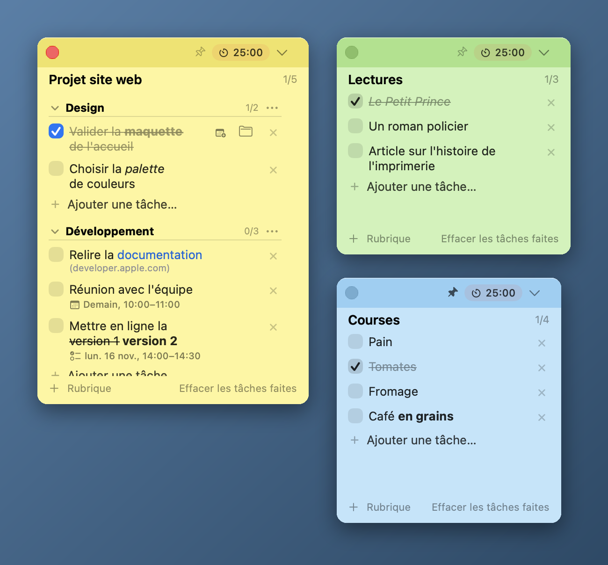
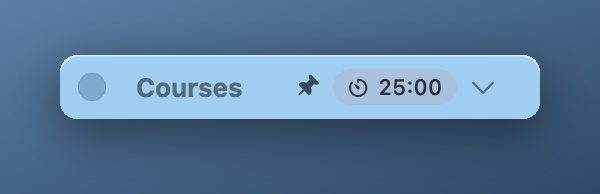
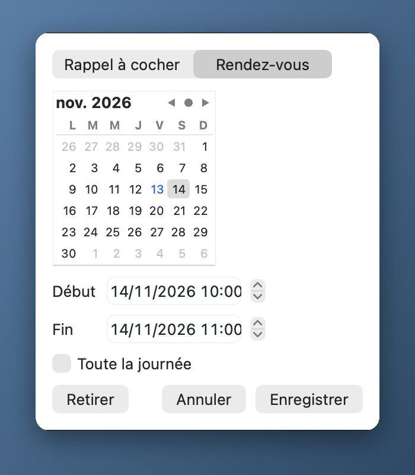
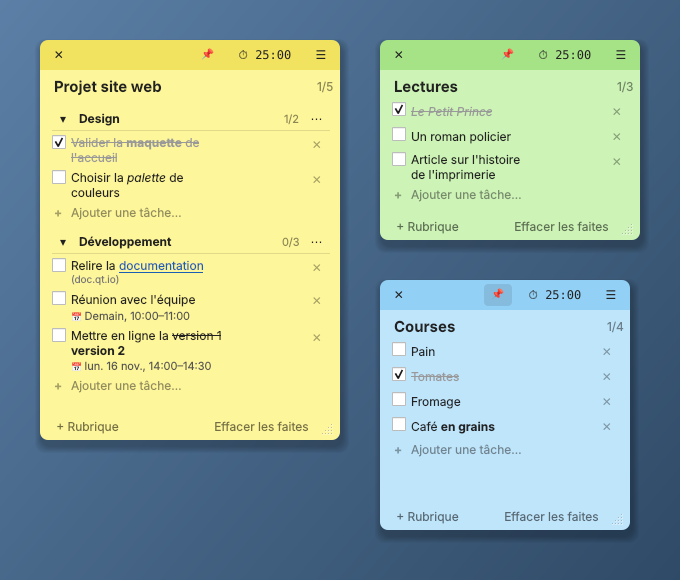
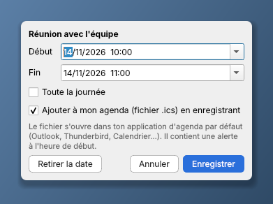

# OPost-it

[English](README.md) · **Français**

Petite app de listes de tâches façon *Stickies*, pour **macOS, Windows et Linux**. Chaque note est une fenêtre colorée posée sur le bureau, avec ses tâches à cocher, un minuteur pomodoro et un lien avec ton agenda.

### macOS



<p align="center">
  
  
</p>

### Windows et Linux



<p align="center">
  
  
</p>

<sub>Captures faites en mode démo, avec des notes fictives.</sub>

Le dépôt contient deux versions, avec les mêmes idées mais un code différent :

| | macOS | Windows / Linux |
|---|---|---|
| Dossier | [`macos/`](macos) | [`desktop/`](desktop) |
| Technologie | Swift (SwiftUI + AppKit) | Python + Qt (PySide6) |
| Agenda | Synchronisé avec Calendrier et Rappels, dans les deux sens | Export `.ics` vers n'importe quel agenda (Outlook, Thunderbird, Google…) |

## Fonctionnalités

- **Notes flottantes** : six couleurs, redimensionnables, enregistrées automatiquement.
- **Punaise** : garde une note au premier plan. Quand tu passes à une autre app, les notes épinglées se replient en une fine barre qui garde le titre et le pomodoro.
- **Transparence** réglable note par note (100 % à 40 %).
- **Rubriques** : regroupe les tâches sous des intitulés repliables (raccourci, ou `# Nom` dans un champ d'ajout).
- **Mise en forme Markdown** : `**gras**`, `*italique*`, `~~barré~~`, `` `code` ``, `[lien](https://…)`. Les adresses web collées deviennent cliquables. Par sécurité, seuls les liens `http`, `https` et `mailto` sont cliquables, et la vraie destination d'un lien s'affiche quand son texte ne la montre pas.
- **Pomodoro** par note, avec durées de travail et de pause réglables.
- **Dates** : chaque tâche peut recevoir un début et une fin, ou être marquée « toute la journée ».
  - Sur macOS, elle devient au choix un **rappel à cocher** ou un **rendez-vous** dans Calendrier, synchronisé dans les deux sens.
  - Sur Windows et Linux, un fichier `.ics` s'ouvre dans ton agenda par défaut, avec une alerte. OPost-it affiche aussi une notification à l'heure de début.

### Raccourcis

| Action | macOS | Windows / Linux |
|---|---|---|
| Nouvelle note | ⌘N | Ctrl+N |
| Nouvelle rubrique | ⇧⌘N | Ctrl+Maj+N |
| Couleur | ⌘1 à ⌘6 | Ctrl+1 à Ctrl+6 |
| Gras / italique | ⌘B / ⌘I | Ctrl+B / Ctrl+I |
| Barré / code | ⇧⌘X / ⌘E | Ctrl+Maj+X / Ctrl+E |
| Lien | ⌘K | Ctrl+K |
| Supprimer la note | ⌘W | Ctrl+W |

## Installation

### macOS

Prérequis : macOS 14 (Sonoma) ou plus récent, et les outils de développement d'Apple (`xcode-select --install`, gratuits, sans Xcode complet).

```bash
git clone https://github.com/allanddt1-stack/OPost-it.git
cd OPost-it/macos
./install.sh
```

Le script compile l'app, l'installe dans `/Applications` et la lance. Elle est signée localement et n'est pas notariée par Apple.

### Windows

Télécharge `OPost-it.exe` dans la page **Releases** du dépôt, puis lance-le. Windows SmartScreen peut avertir que l'éditeur est inconnu, car l'exécutable n'est pas signé : clique sur « Informations complémentaires », puis « Exécuter quand même ».

Pour le lancer au démarrage : `Win+R`, tape `shell:startup`, puis place un raccourci vers `OPost-it.exe` dans ce dossier.

### Linux

Télécharge `OPost-it-Linux.tar.gz` dans **Releases**, puis :

```bash
tar -xzf OPost-it-Linux.tar.gz
./install-linux.sh      # installe dans ~/.local/bin et ajoute OPost-it au menu des applications
```

Certaines distributions minimales ont besoin de `libxcb-cursor0` (Debian/Ubuntu : `sudo apt install libxcb-cursor0`).

### Lancer depuis les sources (Windows / Linux / macOS)

```bash
cd desktop
pip install -r requirements.txt
python postit.py
```

## Mode démo

Pour essayer l'app ou faire des captures d'écran sans montrer tes vraies notes, lance-la avec `--demo`. Elle ouvre alors trois notes fictives. Tes données ne sont ni lues ni modifiées, et rien n'est envoyé à l'agenda.

```bash
open -n -a OPost-it --args --demo      # macOS (peut tourner à côté de ta OPost-it habituelle)
python postit.py --demo               # Windows / Linux, depuis le dossier desktop/
OPost-it.exe --demo                    # Windows, exécutable téléchargé
```

Sur macOS, [`macos/capture-demo.command`](macos/capture-demo.command) refait les captures de ce README d'un double-clic : l'app ouvre ses notes de démonstration, enregistre une image de chaque fenêtre dans `~/Desktop/OPost-it-captures`, puis se ferme.

## Compilation automatique

Le fichier [`.github/workflows/build.yml`](.github/workflows/build.yml) fait compiler par GitHub les versions Windows et Linux à chaque envoi sur `main`. Elles sont téléchargeables dans l'onglet **Actions**. Pour publier une version dans **Releases** :

```bash
git tag v1.0
git push --tags
```

## Données et confidentialité

- Les notes sont enregistrées en local dans un fichier `notes.json`, lisible par ton seul compte et non chiffré :
  - macOS : `~/Library/Application Support/Post-it/`
  - Windows : `%APPDATA%\Post-it\Post-it\`
  - Linux : `~/.local/share/Post-it/Post-it/`
- L'app ne se connecte jamais à Internet.
- Sur macOS, les tâches datées sont copiées dans ton calendrier et ta liste de rappels par défaut, qui se synchronisent avec iCloud. Vérifie que ces calendriers ne sont pas partagés si tes tâches sont privées.

## Licence

[MIT](LICENSE) © 2026 Allan Didot

« Post-it » est une marque déposée de 3M. Ce projet n'a aucun lien avec 3M.
