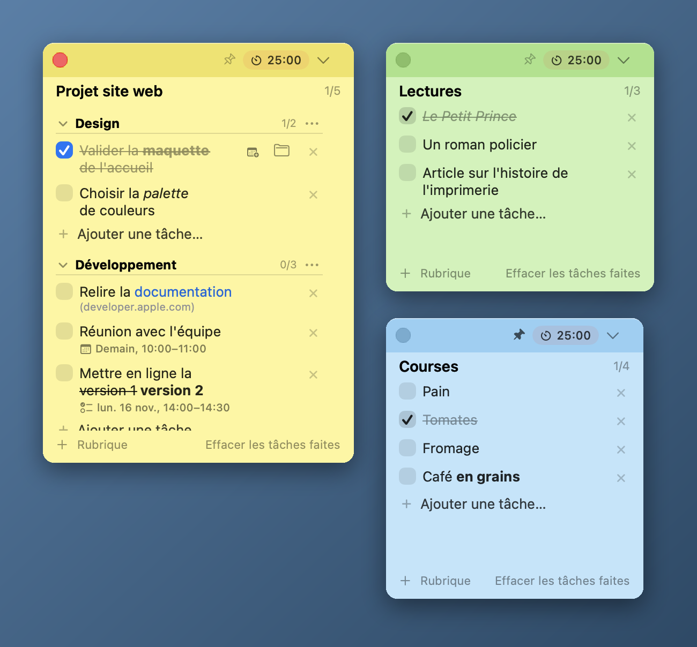
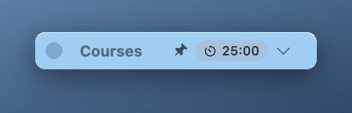
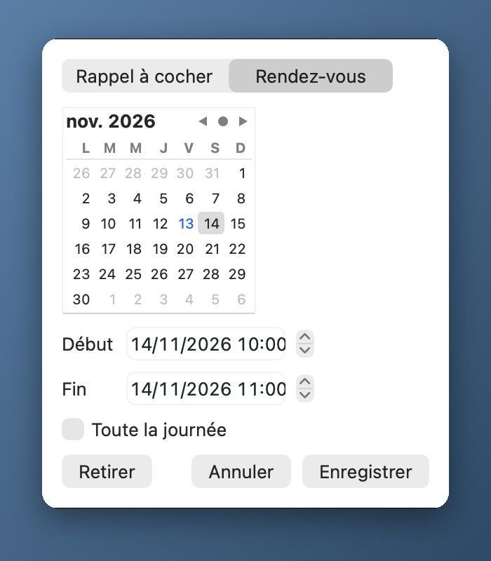
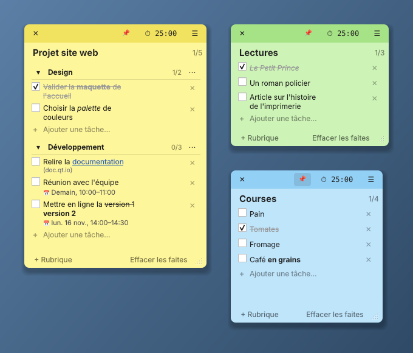
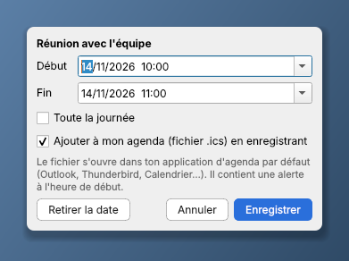

# OPost-it

**English** · [Français](README.fr.md)

**OPost-it is a free, open-source application** ([MIT license](LICENSE)): a small *Stickies*-style to-do app for **macOS, Windows and Linux**. Each note is a colored window on your desktop, with its own checklist, a pomodoro timer and a link to your calendar.

> The app's interface is in French. Menus and buttons are short, and the shortcuts below work the same in any language.

### macOS



<p align="center">
  
  
</p>

### Windows and Linux



<p align="center">
  
  
</p>

<sub>Screenshots taken in demo mode, with made-up notes.</sub>

The repository holds two versions that share the same ideas but not the same code:

| | macOS | Windows / Linux |
|---|---|---|
| Folder | [`macos/`](macos) | [`desktop/`](desktop) |
| Technology | Swift (SwiftUI + AppKit) | Python + Qt (PySide6) |
| Calendar | Two-way sync with Apple Calendar and Reminders | `.ics` export to any calendar app (Outlook, Thunderbird, Google…) |

## Features

- **Floating notes**: six colors, resizable, saved automatically.
- **Pin**: keeps a note above other windows. When you switch to another app, pinned notes collapse into a thin bar that still shows the title and the pomodoro.
- **Transparency**, set note by note (100% to 40%).
- **Sections**: group tasks under collapsible headings (keyboard shortcut, or type `# Name` in an "add task" field).
- **Markdown formatting**: `**bold**`, `*italic*`, `~~strikethrough~~`, `` `code` ``, `[link](https://…)`. Pasted web addresses become clickable. For safety, only `http`, `https` and `mailto` links can be clicked, and a link's real destination is shown next to it when its text doesn't reveal it.
- **Pomodoro timer** in every note, shown at the top of the note (⏱ 25:00):
  - click it to start or pause a work session;
  - when it ends, a sound plays and the timer switches to a break (☕), then back to work;
  - work length (15 to 60 min) and break length (5 to 20 min) are set note by note, from the arrow next to the timer on macOS or the ☰ menu on Windows/Linux;
  - it keeps running and stays visible when a pinned note is collapsed into a bar.
- **Dates**: any task can get a start and an end, or be marked "all day".
  - On macOS, it becomes either a **reminder to tick off** or an **appointment** in Calendar, synced both ways.
  - On Windows and Linux, an `.ics` file opens in your default calendar app, with an alert. OPost-it also shows a notification at the start time.

### Shortcuts

| Action | macOS | Windows / Linux |
|---|---|---|
| New note | ⌘N | Ctrl+N |
| New section | ⇧⌘N | Ctrl+Shift+N |
| Color | ⌘1 to ⌘6 | Ctrl+1 to Ctrl+6 |
| Bold / italic | ⌘B / ⌘I | Ctrl+B / Ctrl+I |
| Strikethrough / code | ⇧⌘X / ⌘E | Ctrl+Shift+X / Ctrl+E |
| Link | ⌘K | Ctrl+K |
| Delete note | ⌘W | Ctrl+W |

## Installation

### macOS

Requirements: macOS 14 (Sonoma) or later, and Apple's command line developer tools (`xcode-select --install`: free, no need for the full Xcode).

```bash
git clone https://github.com/allanddt1-stack/OPost-it.git
cd OPost-it/macos
./install.sh
```

The script builds the app, installs it in `/Applications` and launches it. The app is signed locally and is not notarized by Apple.

### Windows

Download `OPost-it.exe` from the repository's **Releases** page and run it. Windows SmartScreen may warn that the publisher is unknown, because the executable isn't signed: click "More info", then "Run anyway".

To start it automatically: press `Win+R`, type `shell:startup`, and put a shortcut to `OPost-it.exe` in that folder.

### Linux

Download `OPost-it-Linux.tar.gz` from **Releases**, then:

```bash
tar -xzf OPost-it-Linux.tar.gz
./install-linux.sh      # installs into ~/.local/bin and adds OPost-it to the applications menu
```

Some minimal distributions need `libxcb-cursor0` (Debian/Ubuntu: `sudo apt install libxcb-cursor0`).

### Running from source (Windows / Linux / macOS)

```bash
cd desktop
pip install -r requirements.txt
python postit.py
```

## Demo mode

To try the app, or take screenshots without showing your real notes, start it with `--demo`. It opens three made-up notes. Your own data is neither read nor modified, and nothing is sent to your calendar.

```bash
open -n -a OPost-it --args --demo      # macOS (can run alongside your usual OPost-it)
python postit.py --demo               # Windows / Linux, from the desktop/ folder
OPost-it.exe --demo                    # Windows, downloaded executable
```

On macOS, [`macos/capture-demo.command`](macos/capture-demo.command) recreates this README's screenshots with a double-click: the app opens its demo notes, saves an image of each window to `~/Desktop/OPost-it-captures`, then quits.

## Automatic builds

[`.github/workflows/build.yml`](.github/workflows/build.yml) has GitHub build the Windows and Linux versions on every push to `main`; they can be downloaded from the **Actions** tab. To publish a version on the **Releases** page:

```bash
git tag v1.0
git push --tags
```

## Data and privacy

- Notes are stored locally in a `notes.json` file, readable only by your user account and not encrypted:
  - macOS: `~/Library/Application Support/Post-it/`
  - Windows: `%APPDATA%\Post-it\Post-it\`
  - Linux: `~/.local/share/Post-it/Post-it/`
- The app never connects to the internet.
- On macOS, dated tasks are copied to your default calendar and reminders list, which sync with iCloud. If your tasks are private, check that those calendars aren't shared.

## License

[MIT](LICENSE) © 2026 Allan Didot

"Post-it" is a registered trademark of 3M. This project is not affiliated with 3M.
